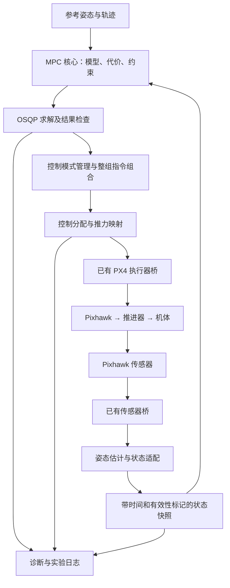

# ROV_Control：C++ MPC 学习与部署路线

调研日期：2026-09-28；学习安排更新：2026-10-22。本文件中的MPC模型/求解器尚未实施。A批数学核心、B批状态/参考、C1有限输入和原Hippo水平到点PD/前馈、姿态保持、物理推力分配已实现，深度仅监测；当前结果见[README](../README.md)。MotorProbe经软件验证、尚未接真机；10-21已生成湿光路候选内参，在线位姿与真机闭环仍待验收。新功能统一C++，在ROV_Control中开发；USTROV为固定外部子模块。10-22用户出差几天无法实机调试，可远程使用WSL/Hippo，近期学习入口见§0。本轮只核读代码、制定安排，没有重跑仿真或实施MPC。

## 0. 出差期间的最小MPC与学习协作（2026-10-22）

### 0.1 当前范围及已有接入点

用户认可当前更多投入learning-based MPC，RL为后续确定希望探索的方向；拟用L1+MPC作主要传统自适应对照。这几天先把名义MPC的建模、预测、优化和执行链学清楚。L1、神经模型和RL不进入这个最小批次。用户随后明确希望直接面向现有四自由度系统；当前改为联合四输入MPC设计，不要求先交付一套独立纵向MPC。标量/两变量算例只用于讲清代价、约束和求解，不成为额外工程阶段，也不用于代表耦合非线性课题已验证。

本轮只读核验到：

- `PointTrackingNode::onTimer()`调用`PlanarTracker::update()`，随后调用`HippoAllocator::allocate()`并发布整组电机命令。
- `PlanarTracker::update()`在TRACKING阶段调用`projectProgress()`得到实际`s_m/v_s_mps`，调用轨迹`sample()`得到参考，再计算纵向PD/前馈物理力。BRAKING、TURNING、HOLDING有独立阶段逻辑，不是所有状态共用一条力公式。
- `QuinticTrajectory::sampleHorizon()`已能按起始时刻、间隔和数量提供未来参考；MPC无需另写一套轨迹生成器。
- 现有状态适配、home、直线路径、姿态PD和Hippo分配可以复用；仿真使用真值，不通过PX4，不是硬件在环或真实定位验收。

当前Hippo物理分配接口的四个控制分量为`u=[F_x,M_x,M_y,M_z]`：机体系前向力N及三轴力矩N·m。它们不等于常见的`x/y/z/yaw`四自由度设定，也不自动决定预测状态只有八维。先从上游动力学、已有`RobotState`及任务输出确定预测状态、平衡点/参考轨迹和需要保留的耦合，再决定固定线性、逐次线性化或非线性形式；不能为了预定求解器硬删必要动态。名义小幅任务可用于首个联合闭环，其他通道的保持同样由联合问题处理。现有PD保留作对照；若四通道均由MPC输出，不再叠加原姿态PD。§4保留俯仰算例作纸面背景，不要求另开俯仰实现工程。

计划的数据流为：真值Odometry→现有状态适配→预测状态＋未来参考→联合MPC请求四分量力/力矩→Hippo分配→推进器→Gazebo运动→下一次反馈；记录参考、实际状态、预测、请求/分配后估计力与求解结果。分配后估计力不是实测真值。接口设计需明确原跟踪阶段逻辑的复用/替换、参考暂停、模型采样周期、首步输入变化率使用值以及失败时行为；不默认为现有阶段逻辑已经适配。

### 0.2 近期按学习轮次推进

每轮预留约2–3小时，可拆到多天；这是工作量预算，不保证固定天数完成。

| 轮次 | 核心问题 | 交付和理解检查 |
|---|---|---|
| 1：当前闭环与模型 | 状态从哪里来、四分量输入去哪里、控制输入与预测状态的区别；模型耦合和近似边界 | 画出数据流及工具职责；确定状态/输入、连续模型、参数来源和首个联合仿真任务；先不写实现 |
| 2：离散化与预测 | Ts怎样进入A/B，未来N步怎样由当前状态与输入决定 | 手推N=3，核对矩阵维数；函数设计确认后实现小模型/预测计算；用解析特例独立核验 |
| 3：代价与约束 | Q/R/变化率惩罚分别影响什么，如何变成QP | 从原始代价推到H/g和约束；明确首步变化率与参考输入；设计确认后实施本批矩阵构造 |
| 4：求解与纯数值闭环 | 约束如何决定最优点；KKT、活跃集/内点/ADMM各在做什么；结果何时可用 | 先完成可手算且有活跃约束的例子；若选凸QP则封装OSQP，完成四输入名义数值闭环、日志及一次参数变化；非线性路线另讲SQP与QP子问题 |
| 5：接回Hippo | 怎样替换原控制输出并保持状态、参考和分配接口一致 | 单独确认接入函数设计，再联调；与同条件PD对照，检查联合饱和、时间和求解失败；注明只完成仿真 |

最初只选名义、小幅可达任务；当前YAML运动要求不能未经检查直接当作MPC实验参考。模型参数、Ts、N、权重和约束在相应设计轮次确定，不提前填入看似精确的“最佳参数”。四输入必须考虑分配矩阵对应的联合可行集合及请求/分配后控制量的差异，不能把四个独立最大值组成的盒约束当成必然可同时实现的控制权限。

### 0.3 用户与Codex的分工

- 用户掌握物理假设、状态/输入定义、离散化、预测/代价/约束的来源，并优先亲自完成一小段核心矩阵或预测函数。无需把所有构建、消息和求解器包装都手写一遍。
- Codex负责梳理已有代码、分步讲解和核查推导；经当前批次确认后完成约定实现、依赖/构建、测试与联调，并解释实际结果。
- 每轮采用“解释一个概念→用户复述或做一个小算例→核对→函数设计确认→实现一个可独立验证的增量→用户先预测一次改动的影响→运行并解释”。不要把所有矩阵和整套实现一次交付，也不要用零碎提问阻碍用户已确认批次的完成。
- 2026-10-22用户细化教学偏好：已有MPC总体认识，重点补代价函数、约束优化和常用求解方法；先建立系统框架、工具职责和完整控制周期，再逐层深入。每个公式的符号、下标、维数、单位/坐标和变量角色都须定义；代价展开与约束矩阵不能跳步。用伪代码/框图及完整可复现小案例串起数学、求解器、C++和仿真；不从零重复Linux/ROS常识。
- 理解以可解释、可修改、可诊断为标准：能说明一条样本如何形成输入；能定位模型/求解/反馈/分配中的故障；能对改变阻尼或输入惩罚提出有依据的趋势判断。测试通过不等于用户已经理解，未得到用户反馈不能记录“已掌握”。
- 每轮收尾只在现有文档记录：本批实际改动/运行证据、用户确认已理解的内容、尚未理解的点和下一小步。README存使用与结果，总体设计存接口，本文件存学习进度；不新增重复阶段报告。

### 0.4 当前停止边界

本轮仅完成学习与设计范围规划，尚未确认任何新增实现批次。第一轮从现有数据流、四输入模型与工具职责开始；待逐项完成函数级设计且用户确认后编码。继续遵守全C++、中文注释、XML `.launch`、不修改外部USTROV、不进入旧`test/pitch_mpc/`等规则。恢复现场条件后，原有定位与执行器验收继续，不用仿真结果替代真机证据。

### 0.5 尚待确认的理解问题（2026-11-09更新）

以下来自本教学对话中的追问，后续讲解不自动将其记为已掌握；待用户解释或计算确认后再更新：

- 二次型中的二分之一与矩阵系数如何配对，参考展开产生的常数项为什么不改变最优输入。
- Hessian、任意方向的二阶变化、正定/半正定和严格凸/凸之间的逻辑关系。
- 凸二次目标与线性约束各自的定义、具体例子的判别，以及它们如何共同构成凸QP；2026-11-09用户明确追问。
- 约束限制可行改动方向后，为什么引入乘子；乘子如何进入驻点与互补条件。已围绕两步输入例子讲解，尚待用户解释或计算确认。
- OSQP作为求解器与ADMM作为算法的区别；两个变量副本、乘子更新和残差如何共同判定结果。
- 单推进器限制如何变成力/力矩的联合可行集合，为什么各轴分别限幅仍可能不可实现。
- 真实控制周期、预测步与求解器迭代的区别；数值迭代满足约束不等于闭环执行已经验证。

## 1. 目标与教学方式

2026-10-07硬件验收的历史分步路线见[README§11.12](../README.md)，其中固定航向短程和一维试验属于场地/反馈受限时的核验候选，不是2026-10-22四输入仿真MPC的前置开发阶段。完整逐台测力不作前置，初期真机模型输入可为经核验经验混控的无量纲指令；它不能直接替换现有N/N·m接口。当前不需要先完成完整VIO、六自由度辨识或learning。下面保留理想物理单轴模型作为教学例子，不代表已测真机参数；数值学习可与硬件准备并行。

完成后应能独立解释和修改：动力学模型、离散化、预测矩阵、代价、约束、求解器接口、闭环状态、执行器分配、实时调度与故障诊断。以亲自开发一套 MPC 的能力为交付目标。

每一步按同一顺序进行：物理问题 → 数学与小型数值例子 → 现有代码对应关系 → 函数级设计 → 用户确认 → 实现一小段 → 运行并解释结果。函数级设计必须覆盖输入、输出、单位、内部状态、调用顺序、异常、验证及后续扩展。A 批已按此顺序实施；后续 MPC 仍处于设计阶段。

建议主线：**核验Gazebo与接口 → 四输入模型/优化形式选择 → C++预测与问题构造 → 求解器封装 → ROS 2/Gazebo联合闭环 → 树莓派4B实测。** 凸QP路线优先考虑OSQP；若所选任务需非线性优化，须说明线性化/SQP及求解器选择依据，不能将非线性问题直接送入OSQP。模型、优化问题及控制运行逻辑由我们实现；通用数值求解使用成熟库。新增算法、节点、测试和实验工具统一C++17；CMake、YAML/XML、消息定义和文档保留对应声明格式，启动优先XML。上游已有Python工具作为依赖使用。没有Python原型阶段，不沿用之前的独立俯仰测试工程。NMPC另行评估C++接口与构建方案。

## 2. 开源方案比较

以下依据官方文档与示例源码，属于工程选型证据。本轮未在 Pi 4B 安装或测时，未把项目论文的宣传性能当成本机性能。

| 工具 | 主要职责 | 本路线中的用途与取舍 | 阅读范围及来源 |
|---|---|---|---|
| OSQP | 凸二次规划求解器；支持稀疏矩阵、热启动、C 接口与固定结构代码生成 | 首版推荐。手工将线性 MPC 写成 QP，数学与矩阵直接对应；非线性问题不能原封不动交给它 | 已读官方 [MPC 示例的 Python 代码](https://osqp.org/docs/examples/mpc.html)、[状态码](https://osqp.org/docs/interfaces/status_values.html)、[代码生成](https://osqp.org/docs/codegen/index.html) |
| acados | 面向最优控制问题的求解框架，支持非线性模型、SQP/RTI、结构化 QP 与 C 部署 | 后续 NMPC 主选。先理解离散模型、优化及迭代，再使用生成器；也能处理线性问题 | 已读 [功能及示例说明](https://docs.acados.org/features/index.html)、[安装与架构选项](https://docs.acados.org/installation/index.html)及官方 minimal_example_ocp.py |
| CasADi | 符号模型、自动微分、积分和优化接口 | 与 acados 配合构造模型及导数；也可配 IPOPT 做离线原型。不是完整现成控制器 | 已读 [官方文档](https://web.casadi.org/docs/)介绍、符号与优化接口相关部分，未通读全书 |
| do-mpc | 较高层 Python MPC/MHE 框架 | 适合快速理解模型、控制器与仿真器的组合；本次先手工组装矩阵，之后可用它交叉学习 | 已读 [入门教程](https://www.do-mpc.com/en/latest/getting_started.html)的模型、控制器和仿真示例；未审计整个框架 |
| TinyMPC | 面向受限计算资源的 MPC 求解与代码生成 | 将来把小型线性控制器下沉到微控制器时再评估；当前选用其主项目的线性/凸问题能力作比较，不概括所有扩展项目 | 已读 [ADMM/LQR 背景](https://tinympc.org/solver/background/)、[示例](https://tinympc.org/get-started/examples/)和官方 README |
| UZH rpg_mpc | 四旋翼 MPC 的 ROS 工程实现 | 阅读算法、求解器封装、ROS 控制器的分层；模型与旧 ROS 环境都需要改造 | 已读 [官方 README](https://github.com/uzh-rpg/rpg_mpc)，其测试环境为 ROS Kinetic/Ubuntu 16.04；未做全源码审计 |

上表保留调研范围；do-mpc 和 Python 建模示例不进入当前实现路线。OSQP 提供 [C 接口](https://osqp.org/docs/interfaces/C.html)，可由 C++ 类封装，外部求解器无需重写。acados/CasADi 留作后续非线性阶段评估，不能据此默认引入 Python 生成脚本。求解器版本、依赖和编译选项在实施时固定。参考书为 Rawlings、Mayne、Diehl 的 [MPC: Theory, Computation, and Design](https://sites.engineering.ucsb.edu/~jbraw/mpc/)；本轮仅核对作者主页与获取入口，未通读教材。

## 3. 系统目标 → 整体架构

以下保留**小角度单轴俯仰**的两状态教学模型作为理论例子；实际工程按§0直接设计联合四输入MPC，不单独实现该俯仰控制器。例子用于用较小矩阵说明预测、约束和映射；其标量假设不能替代实际系统耦合建模。下图保留真机部署的职责划分，当前Hippo仿真不经过PX4。Pixhawk直接执行电机命令时不会自动补上其余姿态控制环。

图中 MPC、状态适配、模式管理及诊断接口是计划内容。已有链路提供传输和执行基础，当前并没有上述完整 MPC 系统。

当前仓库事实：

- `ustrov_control/config/actuator_mixer/ustrov_default.yaml` 的输入顺序是 `[Mx, My, Mz, Fx, Fy, Fz]`；前四路有效，后四路为零，Fy/Fz 列为零。它描述软件分配假设，真实可控轴、符号与耦合仍需实测。
- 混控推力曲线明确借用 Hippo 参数；矩阵不能直接视为本机已标定的 N/N·m 映射。读入 `input_limits` 也不代表运行代码已执行这些限制。
- `ustrov_core/src/px4_actuator_bridge.cpp` 设置 `direct_actuator=true`，绕过 PX4 内部控制器。已有默认 50 Hz 输出、300 ms 指令看门狗、预发送、模式确认、解锁/停机状态机。MPC 不拥有绕过这些逻辑的权限。
- `ustrov_bringup/launch/core.launch.py` 启动 Agent、传感器桥、执行器桥和 mixer；不自动启动状态估计或控制器，不自动解锁。
- 当前估计器输出 pose、velocity、state、attitude 等消息，并不直接发布已有部分控制节点所需的 `nav_msgs/Odometry`。首版需要明确定义状态适配。
- 传感器桥把 FRD 转换为 FLU，IMU 消息并未提供有效融合姿态。不能从消息存在直接推断俯仰角已可用。深度控制还需核实实际水压传感器，不能把飞控气压计直接当深度计。

## 4. 第一课的模型与优化问题

教学模型取小角度俯仰，忽略其他轴耦合，输入先定义为理想力矩：

\[
x=[\theta,\omega_y]^T,\qquad u=\tau_y,
\]
\[
\dot\theta\approx\omega_y,\qquad J_y\dot\omega_y=u-D_y\omega_y-K_\theta\theta.
\]

这只在相应姿态范围和坐标约定下成立。J 是总等效惯量，D 是局部线性阻尼，K 是该平衡点的恢复系数；参数要从已核验的仿真动力学或实测取得。若输入只有归一化命令 c，应建模 `J·ωdot = g(c) - D·ω - K·θ` 或辨识命令到运动的局部模型，不能将 c 直接标成 N·m。

\[
A_c=\begin{bmatrix}0&1\\-K_\theta/J_y&-D_y/J_y\end{bmatrix},\qquad
B_c=\begin{bmatrix}0\\1/J_y\end{bmatrix}.
\]

先讲 Euler 的直观含义，再讲零阶保持离散化：采样间隔内命令不变，得到 `x[k+1] = A x[k] + B u[k]`。用增广矩阵指数计算 A、B，可避免假设 Ac 可逆；用解析特例和独立数值积分核对结果。

先手算 N=3：

\[
\begin{bmatrix}x_1\\x_2\\x_3\end{bmatrix}=
\begin{bmatrix}A\\A^2\\A^3\end{bmatrix}x_0+
\begin{bmatrix}B&0&0\\AB&B&0\\A^2B&AB&B\end{bmatrix}
\begin{bmatrix}u_0\\u_1\\u_2\end{bmatrix}.
\]

这就是 `X = Sx·x0 + Su·U`。控制器通过选择未来输入序列 U，改变未来状态 X。下一时刻用新测量重新预测，只执行本次最优序列的第一个输入。

随后设计代价：

\[
\mathcal J=\sum_{i=0}^{N-1}\left(e_i^TQe_i+(u_i-u_i^{ref})^TR(u_i-u_i^{ref})+\Delta u_i^TS\Delta u_i\right)+e_N^TPe_N.
\]

其中 e 为状态跟踪误差；Q 决定角度/角速度误差权重，R 惩罚偏离参考输入，S 抑制输入突变，P 是终端权重。权重需结合量纲和归一化理解。恒定非零角度的理想保持输入为 `u_ref=Kθ·θ_ref`；动态参考需同时考虑惯量与阻尼，不能默认所有参考输入为零。终端权重来自 LQR 时，要解释其假设；仅设置 P 不自动获得受约束系统的稳定性或递归可行性证明。

约束按层引入：动力学与初值等式 → 输入上下限 → 输入变化率 → 状态边界与松弛变量。实际输入限幅保留为硬约束；可软化的状态跟踪边界与真实物理禁区要分别定义。避免把已经越界的 x0 同时强制在硬边界内，导致问题先天不可行。

压缩状态后得到标准 QP：

\[
\min_U \tfrac12U^THU+g^TU,\qquad l\le CU\le h.
\]

H、g、C、l、h 的每块都要从原式推出，包括二次型的 1/2 系数、参考项和首步变化率项。之后再读 OSQP 官方保留全部状态变量的稀疏写法，比较变量数和稀疏性。热启动只用于加速，不能替代对当前结果的检查。

## 5. 一步步推进及完成标志

| 步骤 | 算法要学会什么 | 工程产物与完成标志 |
|---|---|---|
| 0. 控制对象和接口 | 谁估计状态、谁算控制、谁分配推力；命令与物理力的区别 | 核验 Gazebo 环境、动力学与反馈；现采用 Control_Sys_AUV 主仓库，自研 ROV_Control + 外部 USTROV 子模块 |
| 1. 四输入模型 | 状态空间、耦合、平衡点/局部线性化、离散化、模型预测 | C++模型与解析特例对照；小矩阵手算仅为理解和核验工具，不新增独立单轴工程 |
| 2. 无约束预测控制 | N=3 预测矩阵、有限时域二次型、与 LQR 的联系 | 手算与程序预测一致；理解为什么不能直接使用有约束问题的解析解 |
| 3. 约束 MPC + OSQP | 推导 QP；输入/变化率/状态约束；松弛变量；ADMM 和残差的基本意义 | C++ 数值闭环；与解析无约束解及构造的约束案例对照；说明哪些约束变活跃 |
| 4. 闭环调试 | Q/R/S/P、N、Ts；模型误差、偏置、积分或扰动状态；不可行和超时 | 比较 PID 与 MPC；测试阶跃、平滑参考、偏置、噪声、延迟、饱和及求解中断；解释失败原因 |
| 5. C++ 核心整理 | 缓存固定矩阵、热启动、数值尺度、稀疏存储 | 纯 C++/Eigen + OSQP C API；核心无 ROS 依赖，建立确定性数值测试 |
| 6. ROS 2 与仿真 | 时间戳、状态快照、配置生命周期、模式与消息所有权 | 先日志回放和只算不输出，再接仿真；区分真实估计器与仿真 ground truth；解算与心跳解耦 |
| 7. Pi 4B 与真机 | 总时延、抖动、控制分配、推力校准、受限试验 | Pi 原生性能测量；通信/符号验证后逐步闭环；每条命令可追溯到状态、模型版本和求解结果 |
| 8. 研究扩展 | 负载变化、模型适应；必要时非线性建模、SQP/RTI | 四输入耦合和联合可行集合已在首版设计考虑；八推进器须重新核验分配与动力学，learning另批设计 |

学习以理解和验证结果为推进依据。第一轮纯数值原型可在主力机运行；Gazebo 和可视化优先留在主力机，树莓派承担实际需要的估计、控制与通信。

## 6. 运行时流程与数据结构

四输入凸QP路线每周期依次：读取参考与有效状态快照 → 检查状态年龄及时间对齐 → 更新QP中随状态/参考变化的数据 → 限时求解 → 检查状态码、残差、数值有限性、约束及解的年龄 → 取第一步四分量控制 → 分配并发送 → 记录预测、输入及诊断。不与同轴原姿态PD重复叠加。

求解器返回一个数组不能等同成功。OSQP 的 solved inaccurate、迭代上限、超时、不可行各有含义，接受条件需显式设计。求解失败时是否能切换 PID，取决于 PID 是否验证及当前反馈是否有效；不能假定 PX4 会自动接管姿态。也不能不断发布旧结果刷新看门狗。

下表为以§4标量例子说明职责的结构草案，不是已存在的接口；θ/ωy和J/D/K仅为该例字段，四输入工程的状态与参数须按§0重新设计，不能照搬：

| 结构 | 内容 | 谁使用/维护 |
|---|---|---|
| StateSnapshot | θ、ωy、源时间、接收时间、有效性、坐标/来源标识 | 状态适配层生成，控制周期读取不可变快照 |
| ModelParameters | J、D、K 或命令域系数；Ts；模型版本与单位 | 初始化/停控重配，首版固定；未来更新必须原子采用 |
| MpcConfig | N、Q/R/S/P、约束、尺度、容差、迭代/时间预算 | 初始化校验；不在求解中途改变维度 |
| ReferenceHorizon | x_ref[0:N]、u_ref[0:N-1]、参考时间 | 参考生成器输出，与本周期采样网格一致 |
| SolverResult | 状态、迭代数、残差、耗时、预测 X/U、模型版本 | 求解后生成；通过有效性检查才允许取控制量 |
| AppliedCommandRecord | 请求控制、分配后命令、分配估计的实现力矩、发送时间、有效期、是否有执行确认 | 输出层与日志维护；估计实现力矩不是测量真值 |

首步 `Δu0` 使用已知最近施加的输入；真机通常只有已发送命令与分配模型估计，必须标明这种近似和延迟，不能冒充已测真实力矩。没有执行反馈时记录“未确认”，并在模型/约束中考虑这一差距。

## 7. 模块 → 文件 → 函数的初步设计

下表是ROV_Control的C++凸QP路线草案，实施前逐步讲解并确认。新包使用`rov_`前缀，避免与USTROV的包同名覆盖。当前工程以PATH_TRACKING_DESIGN.md §1–8为准，状态预览、输入核验和水平到点PD软件闭环已完成。下一步在同一状态/轨迹/执行链上设计联合四输入MPC，先讲清模型、优化形式与接口再实现；不得据此自动批量生成文件。

| 模块/计划文件 | 类/函数与输入→输出 | 内部状态及调用关系 |
|---|---|---|
| model.h/.cpp | continuousMatrices(params)→Ac,Bc；discretize(Ac,Bc,Ts)→A,B；step(x,u,A,B)→x_next | 纯函数；被预测矩阵构建和数值被控体调用 |
| prediction.h/.cpp | buildPrediction(A,B,N)→Sx,Su | 纯函数；模型或时域变化时重建 |
| qp_builder.h/.cpp | buildStaticProblem(model,config)→H,C,索引；updateOnlineData(x,reference,u_prev)→g,l,h | 缓存固定结构；解释哪些量每周期变，哪些无需重算 |
| osqp_backend.h/.cpp | setup(problem,settings)；solve(g,l,h)→SolverResult；reset() | 持有求解器工作区/热启动；只负责优化，不发 ROS 消息 |
| linear_mpc.h/.cpp | LinearMpc::step(snapshot,reference,u_prev)→请求输入与诊断；reset() | 组合问题更新、求解和结果检查；积分扩展时显式增加内部状态 |
| scenario_runner.cpp | runScenario(plant,controller,reference,disturbance)→时间序列 | 管理仿真时钟和被控体状态；模型参数可分离 |
| metrics.h/.cpp | evaluateRun(log)→误差、约束、求解统计 | C++ 计算指标并导出 CSV；已有可视化工具显示结果 |

拟分为 `rov_control_core`（纯 C++ 数学库）、`rov_control_ros`（ROS 适配）、`rov_bringup`（声明式启动和配置），实验工具按规模再独立成包。`state_adapter.h/.cpp` 管理反馈与快照；`mpc_node.cpp` 负责订阅、定时调用和诊断发布；YAML 与 XML .launch 显式配置命名空间和模式。自研代码按用户 Glider_sim 风格使用 `.h/.cpp`、小驼峰函数与中文注释。文件名和函数签名在各阶段单独冻结，不提前批量生成。

以下为真机部署阶段的复用注意点；当前Hippo仿真的实际复用入口以§0为准，已有整组命令发布路径，不重新搭建第二套分配链：

- 复用 `ustrov_core` 的 PX4 消息、传感转换、执行器桥和状态机。
- 复用`ustrov_state_estimation`前核验坐标、延迟、初始化及有效性；实际任务所需位置/速度反馈须有对应观测来源，不能由姿态有效推断全部预测状态可用。
- 复用 `ustrov_control` 的分配入口前先标定本机映射。mixer 的 thrust/torque 分别回调并立即发布，属于两个缓存，不能假定整组控制原子更新。单轴受限实验可明确固定其他输入；多轴实施前必须设计统一组合与命令发布者。
- `ustrov_sim`用于系统联调。2026-10-22当前MPC范围已改为联合四输入；小矩阵例子服务优化理解，不形成独立单轴交付要求。不接遥控叠加、学习模块或滑翔机固件，视觉属于真机反馈验收。
- 现有 PID 可用于基线/其他轴控制，但其消息接口和稳定性须核验；禁止同一控制轴由多个节点同时发布竞争指令。

## 8. 当前代码的推荐阅读顺序

1. `ustrov_sim/launch/top_hippocampus_complete.launch.py` 与 `spawn_vehicle.launch.py`：仿真启动了哪些组件、默认使用什么反馈。
2. `ustrov_sim/src/static_bridge.cpp` 与 `fake_state_estimator.cpp`：推进器命令如何进入 Gazebo、真值怎样进入控制反馈。
3. `ustrov_control/src/mixer/actuator_mixer_node.cpp` 与 `simple_mixer.cpp`：消息缓存、超时、混控、推力映射与归一化。分配饱和后请求力矩与实现力矩可能不同。
4. `ustrov_core/src/px4_actuator_bridge.cpp`：onThrusterCommand → OnOutputTimer → PublishOffboardHeartbeat/PublishMotorOutput；理解指令有效性、解锁阶段与直接电机输出。
5. `ustrov_state_estimation/src/estimator.cpp`：OnImu 与输出消息，确定 θ、ωy 的来源及时间对齐。
6. `ustrov_bringup/launch/core.launch.py`：理解启动清单与尚需显式添加的 MPC/估计器节点。

上列路径相对于外部 USTROV 的 `ustrov_ws/src/`。新控制代码在 ROV_Control；旧独立数值测试不进入当前阅读、复用或开发范围。

## 9. 树莓派性能与四改八的工程决定

采样周期 Ts 由系统带宽、反馈率和端到端时延确定；预测时长为 N·Ts。已有桥 50 Hz 只说明发送节拍，不能证明 MPC 的实时能力。记录 setup、update、solve、分配与总周期各自耗时，报告 p50/p95/p99、实测最大值和超期次数；检查热降频、同时运行估计和通信的影响。实测最大值不是硬实时最坏执行时间证明。

固定问题尽量在初始化时分配和分解，每周期更新向量；模型改变时按求解器接口处理矩阵。OSQP 代码生成可作为后续优化选项：问题维度固定，矩阵模式还要求固定稀疏结构；首版 C API 性能足够时无需额外维护生成链。OS 与 ARM64 环境、ROS 2 版本、PX4/px4_msgs 匹配关系先实测确认。

将推进器变化隔离在分配层：`wrench = G·f`，其中 f 是各推进器推力，G 由方向和力臂确定。本仓库的 mixer 是从控制输入到电机输出的映射，不要与这里的物理 G 混为一谈。四路变八路时重新核对位置、方向、推力曲线、秩/条件数和可达力矩范围；新增部件也可能改变 J、D、K 和耦合。

如果 MPC 输出广义力，输入维度可以保持，分配器处理电机数量变化；但 MPC 约束仍须反映分配器真正能实现的控制集合。各轴独立的最大力矩同时使用时可能不可达。首版采用经验证的保守范围，后续再引入分配约束或把推进器输入直接纳入优化。

完成本路线的标准：能说明每个矩阵从哪里来；能替换模型、改约束并预测效果；能解释一次失败是模型、求解、反馈、调度还是分配造成；同一控制核心经过数值、接口、Pi 测时与受限真机验证。关于性能提高的结论来自相同条件下的测量。

